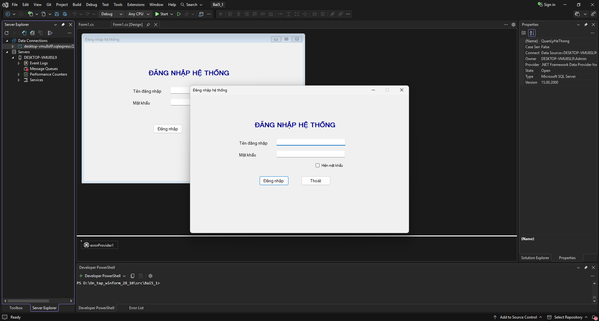
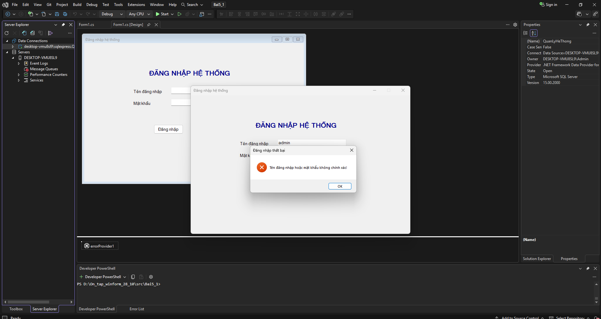
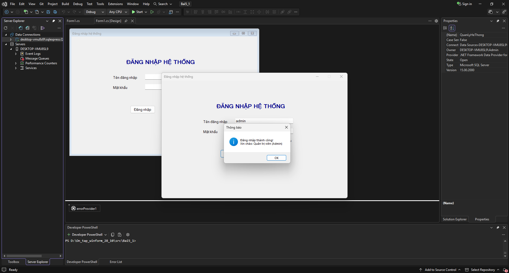
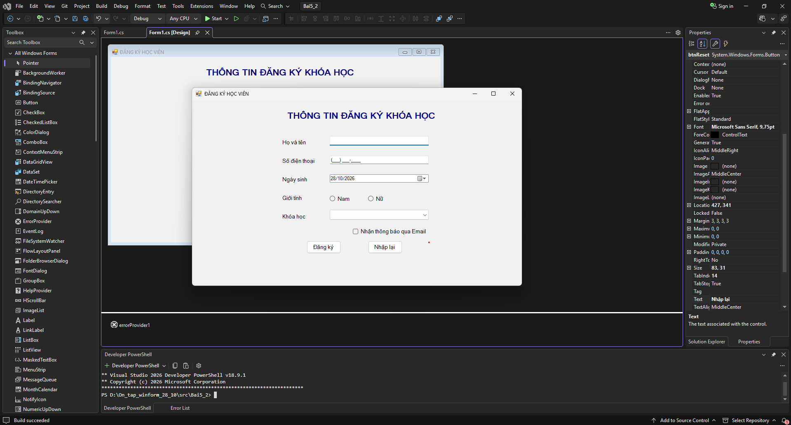
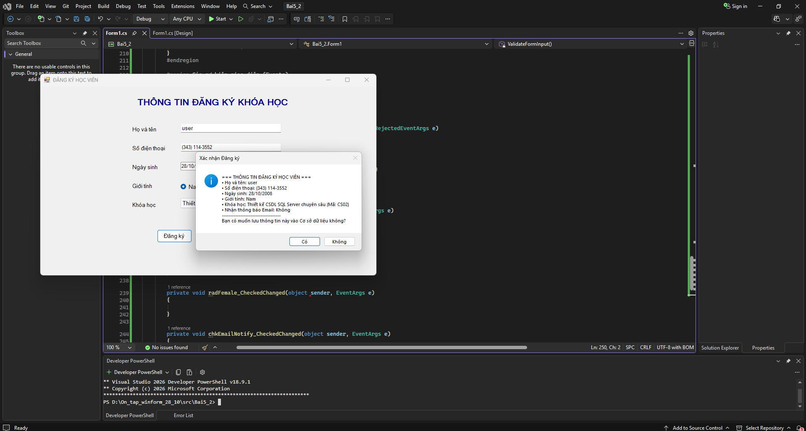
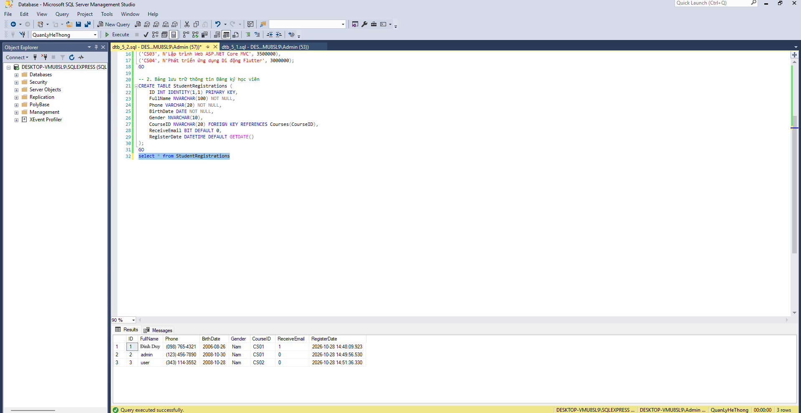

# BÁO CÁO BÀI TẬP THỰC HÀNH LẬP TRÌNH C# WINFORMS

## I. THÔNG TIN SINH VIÊN

- **Họ và tên:** Trần Đình Duy
- **Mã số sinh viên:** 24810320299
- **Lớp học phần:** Lập trình .NET - Mã Lớp: D19QTANM1
- **Link Repository:** https://github.com/duytrandanghoccode/Bai_tap_5.1_5.2

---

## II. DANH SÁCH BÀI TẬP HOÀN THÀNH & TỰ ĐÁNH GIÁ

| Bài tập | Tiêu đề bài tập | Trạng thái | Mức độ hoàn thành (%) |
| :---: | :--- | :---: | :---: |
| **Bài 5.1** | Hệ thống Đăng nhập, Validation & Xác thực SQL Server | Hoàn thành | 100% |
| **Bài 5.2** | Đăng ký Khóa học (Data Binding ComboBox, MaskedTextBox & CSDL) | Hoàn thành | 100% |

---

## III. MINH HỌA GIAO DIỆN & KỸ THUẬT NỔI BẬT

### 1. Bài 5.1: Hệ thống Đăng nhập & Xác thực Tài khoản
- **Kỹ thuật áp dụng:**
  - Kết nối Cơ sở dữ liệu SQL Server (`DESKTOP-VMU8SL9\SQLEXPRESS`), sử dụng `SqlParameter` chống tấn công SQL Injection.
  - Bắt lỗi dữ liệu nhập với `ErrorProvider` (kiểm tra rỗng tên đăng nhập và mật khẩu).
  - Tùy biến bảo mật hiển thị mật khẩu bằng `chkShowPassword` (`UseSystemPasswordChar`).
  - Thiết lập phím tắt chuẩn WinForms: phím **Enter** kích hoạt `AcceptButton` (Đăng nhập) và phím **Esc** kích hoạt `CancelButton` (Thoát).
- **Hình ảnh minh họa Giao diện:**


*Mô tả: Giao diện Form Đăng nhập hệ thống được căn giữa màn hình (`CenterScreen`) với đầy đủ các trường nhập liệu.*


*Mô tả: Hộp thoại thông báo khi người dùng đăng nhập sai thông tin hoặc kích hoạt cảnh báo ErrorProvider khi bỏ trống.*


*Mô tả: Thông báo đăng nhập thành công, hiển thị Họ tên và Vai trò (FullName & Role) truy vấn từ bảng Users trong Database QuanLyHeThong.*

---

### 2. Bài 5.2: Đăng ký Khóa học Học viên
- **Kỹ thuật áp dụng:**
  - Nạp dữ liệu danh mục khóa học động từ CSDL lên `ComboBox` qua kỹ thuật **Data Binding** với cặp thuộc tính `DisplayMember` (hiển thị CourseName) và `ValueMember` (nhận ngầm CourseID).
  - Định dạng nhập số điện thoại chuẩn qua `MaskedTextBox` với mặt nạ `Mask = "(000) 000-0000"` và kiểm tra độ dài bằng `MaskFull`.
  - Định dạng ngày tháng ngắn tiếng Việt qua `DateTimePicker` (`CustomFormat = "dd/MM/yyyy"`).
  - Lựa chọn giới tính với `RadioButton` và tùy chọn thông báo với `CheckBox`.
  - Nút **Đăng ký**: Tổng hợp chi tiết thông tin học viên in ra `MessageBox`, sau đó ghi trực tiếp bản ghi vào bảng `StudentRegistrations` trong CSDL SQL Server.
  - Nút **Nhập lại**: Xóa trắng các trường nhập liệu và reset trạng thái form ban đầu.
- **Hình ảnh minh họa Giao diện:**


*Mô tả: Giao diện Form Đăng ký khóa học tải danh mục khóa học tự động từ CSDL vào ComboBox.*


*Mô tả: Hộp thoại MessageBox tổng hợp thông tin học viên trước khi xác nhận lưu vào CSDL.*


*Mô tả: Kiểm tra dữ liệu được thêm mới trực tiếp vào bảng trong SQL Server Management Studio (SSMS).*

---

## IV. HƯỚNG DẪN CÀI ĐẶT & CHẠY DỰ ÁN

1. **Cấu hình Cơ sở dữ liệu (SQL Server):**
   - Mở công cụ **SQL Server Management Studio (SSMS)**.
   - Mở và thực thi lần lượt các file script trong thư mục `Database/`:
     - Chạy script `QuanLyHeThong.sql` (hoặc `dtb_5_1.sql`) để khởi tạo database `QuanLyHeThong` và bảng `Users`.
     - Chạy script `dtb_5_2.sql` để tạo bảng `Courses` và `StudentRegistrations`.

2. **Cấu hình chuỗi kết nối:**
   - Chuỗi kết nối được thiết lập trong mã nguồn C#:
     ```csharp
     @"Data Source=DESKTOP-VMU8SL9\SQLEXPRESS;Initial Catalog=QuanLyHeThong;Integrated Security=True;TrustServerCertificate=True"
     ```

3. **Chạy ứng dụng:**
   - Mở solution trong thư mục `src/` bằng **Visual Studio 2022**.
   - Bấm **F5** (hoặc chọn nút **Start**) để biên dịch và chạy từng bài tập.